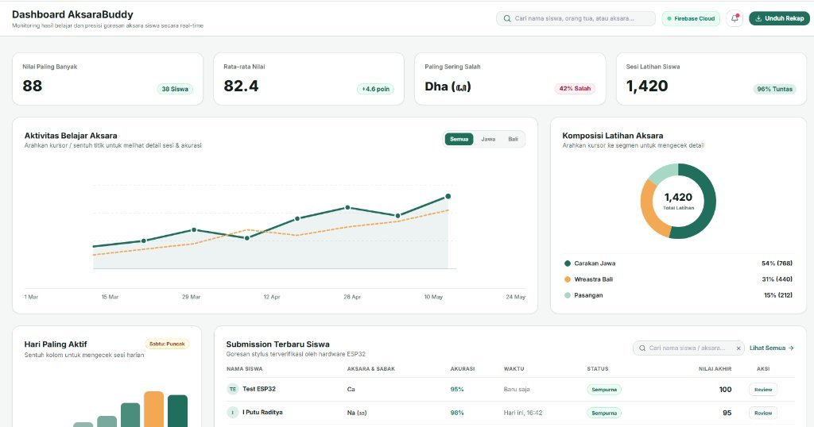
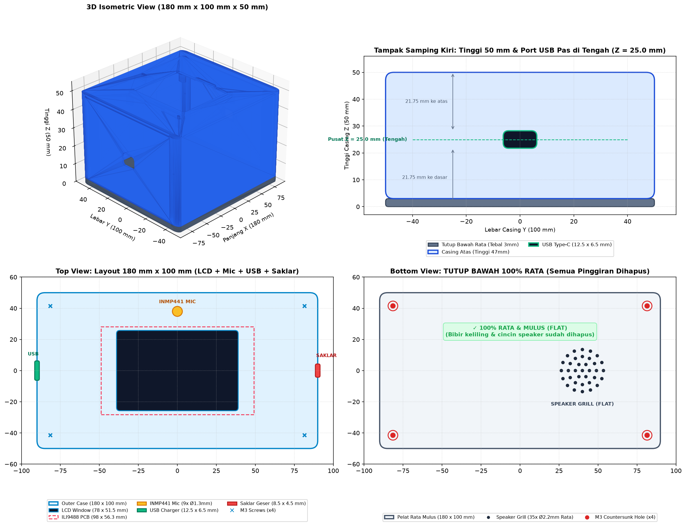
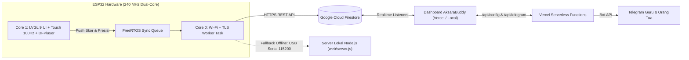

<div align="center">

# 🪶 OpenAksara ESP32 — **AksaraBuddy**
### *Sabak Digital IoT & EduCloud Platform untuk Pembelajaran Aksara Jawa & Aksara Bali*


**Perangkat sabak digital edukasi mandiri berbasis ESP32, layar sentuh 3.5" ILI9488, dan audio DFPlayer Mini yang terhubung secara *real-time* ke Cloud Firestore, Dashboard Monitoring Guru, serta Bot Telegram.**

<br/>


</div>

---

## 📖 Latar Belakang & Inovasi

Menurunnya minat generasi muda dalam mempelajari aksara daerah menjadi tantangan besar dalam pelestarian budaya Nusantara. Pembelajaran yang masih monoton serta tingginya distraksi perangkat digital umum (*smartphone*/tablet) membuat kemampuan membaca dan menulis aksara daerah perlu pendekatan baru.

**AksaraBuddy (OpenAksara ESP32)** hadir sebagai **perangkat IoT edukasi mandiri (*dedicated learning slate*)** yang menggabungkan teknologi *embedded* dan budaya lokal:
- 🎯 **Fokus Tanpa Distraksi:** Perangkat khusus belajar aksara (tanpa game/media sosial).
- ✍️ **Belajar Menulis Interaktif:** Panduan goresan bertitik (*waypoint tracing*), evaluasi presisi *real-time*, efek animasi perayaan, dan umpan balik suara.
- 📡 **Terhubung ke EduCloud:** Guru dan orang tua dapat memantau perkembangan siswa, akurasi goresan, serta capaian XP secara *real-time* lewat web dashboard & Telegram.

---

## 📸 Tampilan Sistem & Ekosistem

### 1. Dashboard Monitoring AksaraBuddy (Web & Vercel Cloud)
Pantau statistik kelas, grafik aktivitas belajar, komposisi latihan (*Carakan Jawa*, *Wreastra Bali*, *Pasangan*), serta *live submission* langsung dari hardware ESP32:

<div align="center">
  
</div>

<br/>

### 2. Desain Casing Fisik & 3D Enclosure
Casing ergonomis berdimensi **180 mm × 100 mm × 50 mm** siap cetak 3D (*3D Print*) dengan tutup bawah *flat* berbaut countersunk M3, cutout layar 3.5", lubang USB-C, saklar geser, serta grill speaker/mikrofon:

<div align="center">
  
</div>

---

## ✨ Fitur Utama

### 📱 Hardware & Firmware ESP32 (`src/`)
- **Dual-Core FreeRTOS Architecture:**
  - **Core 1:** Rendering UI **LVGL v9** yang mulus, polling sentuh resistif **100 Hz**, mesin *tracing* aksara dengan *adaptive lookahead*, serta suara **DFPlayer Mini**.
  - **Core 0:** Background worker (`firebase_sync_worker_task`) untuk koneksi Wi-Fi, sinkronisasi waktu SNTP, dan pengiriman data HTTPS TLS ke **Google Cloud Firestore** tanpa mengganggu kelancaran layar sentuh.
- **Mode Belajar & Kuis Interaktif:**
  - Peta progres Aksara Jawa (*Ha Na Ca Ra Ka* — 20 aksara) dan Aksara Bali (*Ha Na Ca Ra Ka* — 18 aksara).
  - Kanvas menulis interaktif dengan garis panduan, deteksi jalur, efek partikel bintang, dan kalkulasi presisi goresan.
  - Beragam mode kuis interaktif (*Pasangkan*, *Kenali Vokal/Sandhangan*, *Memori Kartu*, *Baca Kata*).
- **Dual Output Telemetry & Fallback:** Mengirim hasil langsung ke Firestore saat Wi-Fi aktif, serta mencetak JSON *real-time* lewat **USB Serial (115200 baud)** saat mode offline.
- **Partisi Memori Lega (`huge_app.csv`):** Alokasi Flash aplikasi **3.14 MB** untuk menampung font aksara raksasa (160px), aset gambar maskot, dan stack jaringan.

### 🌐 Platform Web EduCloud & Serverless (`web/` & `api/`)
- **Server Lokal Zero-Dependency:** [`web/server.js`](web/server.js) berjalan menggunakan modul bawaan Node.js (`http`, `https`, `fs`) tanpa perlu instalasi *library* tambahan, dilengkapi **Server-Sent Events (SSE)** untuk pembaruan instan.
- **Siap Deploy ke Vercel:** Dilengkapi endpoint serverless [`api/config.js`](api/config.js) dan [`api/telegram.js`](api/telegram.js) sehingga kredensial rahasia tetap aman di **Vercel Environment Variables** meski repositori bersifat publik.
- **Notifikasi Telegram Otomatis:** Mengirim laporan skor, akurasi goresan, dan pengingat remedial langsung ke Telegram guru/wali murid.

### 🛠️ Toolchain Pengembang (`waypoint_editor/` & `3d_viewer/`)
- **Visual Waypoint Editor:** Petakan koordinat lintasan goresan aksara secara visual di browser, lalu suntikkan ke kode C++ (`ui_jawa.cpp` / `ui_bali.cpp`) hanya dengan 1 klik lewat GUI PowerShell ([`update_waypoint.bat`](waypoint_editor/update_waypoint.bat)).
- **Interactive 3D Viewer:** Inspeksi model 3D casing (rotasi 360°, zoom, dan mode *Exploded View* bongkar/pasang) langsung di browser berbasis Three.js.

---

## 🏗️ Arsitektur Sistem



---

## 🔌 Spesifikasi Hardware & Pinout

Konfigurasi hardware berdasarkan [`platformio.ini`](platformio.ini):

| Komponen | Spesifikasi / Driver | Pin ESP32 |
| :--- | :--- | :--- |
| **Mikrokontroler** | ESP32 Dev Module (240 MHz CPU, 80 MHz QIO Flash, `huge_app.csv`) | — |
| **Layar TFT LCD** | 3.5" **ILI9488** (480×320 Landscape, SPI 27 MHz) | `CS=15`, `DC=2`, `RST=4`, `MOSI=23`, `MISO=19`, `SCLK=18` |
| **Touchscreen** | **XPT2046** Resistive Touch (SPI 2.5 MHz) | `TOUCH_CS=21` (berbagi bus SPI) |
| **Audio Module** | **DFPlayer Mini** + Speaker | UART Serial2 ESP32 |

---

## 📁 Struktur Direktori

```text
OpenAksara_ESP32/
├── 📁 api/                  # Vercel Serverless Functions (/api/config & /api/telegram)
├── 📁 3d_viewer/            # Model STL 3D Print, preview teknis, & Three.js 3D Viewer
│   ├── index.html           # Viewer 3D interaktif (Exploded View & 360°)
│   ├── models/              # File STL: casing_atas, tutup_bawah, casing_lengkap_assembly
│   ├── docs/                # Dimensi modul LCD 3.5" MSP3520 / ILI9488
│   └── *.py                 # Script generator STL parametrik (Manifold3D)
├── 📁 waypoint_editor/      # Editor visual titik goresan aksara & auto-injector C++
│   ├── index.html           # Kanvas plotter titik mulai (hijau) & akhir (merah)
│   ├── update_waypoint.bat  # Shortcut 1-klik GUI injector ke firmware
│   └── update_waypoint.ps1  # Script injeksi otomatis ke src/ui/ui_jawa.cpp & ui_bali.cpp
├── 📁 web/                  # Platform EduCloud & Dashboard Guru / Orang Tua
│   ├── index.html           # Antarmuka Dashboard AksaraBuddy
│   ├── server.js            # Backend lokal Node.js zero-dependency (REST, SSE, & Telegram bridge)
│   ├── firebase-config.js   # Driver sinkronisasi Firebase Firestore & Auth
│   ├── firebase-keys.example.js # Template konfigurasi Firebase lokal
│   ├── fonts/ & assets/     # Font Aksara Jawa/Bali & maskot AksaraBuddy
│   └── screenshots/         # Dokumentasi tampilan dashboard
├── 📁 src/                  # Kode sumber firmware ESP32 (C++ / Arduino / FreeRTOS)
│   ├── core/                # firebase_sync, audio_player, & telegram_notify
│   ├── ui/                  # UI LVGL 9 (home, jawa, bali, learn, common)
│   └── main.cpp             # Entry point & inisialisasi display/touch
├── 📁 include/              # Header config (lv_conf.h, secrets.example.h)
├── 📁 asset/                # Aset bitmap maskot & avatar (C-array)
├── 📁 docs/images/          # Dokumentasi foto showcase hardware & dashboard
├── platformio.ini           # Konfigurasi build PlatformIO
└── vercel.json              # Konfigurasi routing & rewrites Vercel
```

---

## 🚀 Panduan Instalasi & Menjalankan Project

### 1️⃣ Konfigurasi Rahasia (Secrets & API Keys)
> **Catatan Keamanan:** File kredensial asli (`include/secrets.h`, `.env`, `web/firebase-keys.js`, `telegram_config.json`) sudah masuk `.gitignore` agar aman saat repositori dipublikasikan.

- **Untuk Firmware ESP32:**
  1. Salin `include/secrets.example.h` menjadi `include/secrets.h`.
  2. Isi SSID Wi-Fi, password, serta `FIREBASE_API_KEY` dan `FIREBASE_PROJECT_ID` milikmu.
- **Untuk Web Lokal:**
  - Salin `.env.example` menjadi `.env` dan isi kredensial Firebase + Telegram, **atau** salin `web/firebase-keys.example.js` menjadi `web/firebase-keys.js`.

---

### 2️⃣ Build & Upload Firmware ESP32
Buka project menggunakan **PlatformIO** (VS Code atau CLI), lalu jalankan:
```bash
pio run -e esp32dev --target upload
```
Untuk melihat log telemetri & debug via Serial Monitor:
```bash
pio device monitor -b 115200
```

---

### 3️⃣ Menjalankan Web Dashboard Secara Lokal
Pastikan **Node.js** sudah terpasang, lalu jalankan (atau klik ganda `web/start_server.bat`):
```bash
node web/server.js
```
Akses melalui browser:
- **Dashboard Monitoring:** `http://localhost:3000/`
- **3D Casing Viewer:** `http://localhost:3000/3d`
- **Waypoint Plotter Editor:** `http://localhost:3000/waypoint`

---

### 4️⃣ Deploy ke Vercel (Production Cloud)
Hubungkan repositori GitHub ini ke **Vercel**, lalu tambahkan variabel berikut di menu **Project Settings → Environment Variables**:
- `FIREBASE_API_KEY`
- `FIREBASE_AUTH_DOMAIN`
- `FIREBASE_PROJECT_ID`
- `FIREBASE_STORAGE_BUCKET`
- `FIREBASE_MESSAGING_SENDER_ID`
- `FIREBASE_APP_ID`
- *(Opsional)* `TELEGRAM_BOT_TOKEN` & `TELEGRAM_CHAT_ID`

Endpoint `/api/config` akan menyuplai konfigurasi Firebase Web Client secara dinamis saat dashboard dibuka di Vercel.

---

<div align="center">

Dikembangkan dengan ❤️ untuk pelestarian **Aksara Nusantara**  
**GRED | SIGMA BOY — OpenAksara ESP32**

</div>
