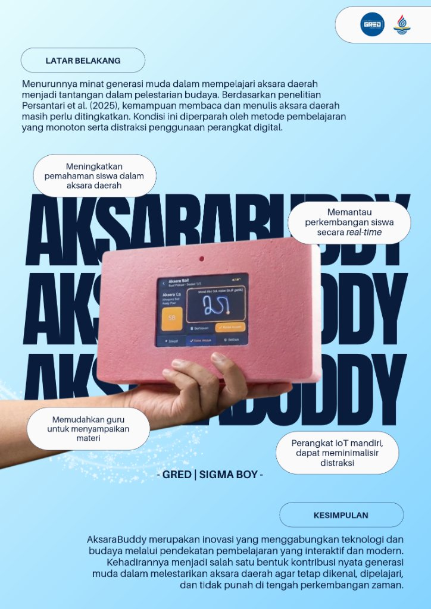
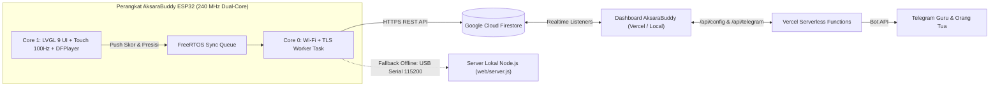

<div align="center">

# 🪶 AksaraBuddy — Sabak Digital IoT Pembelajaran Aksara Jawa & Aksara Bali (ESP32)

### *Smart Interactive Cultural Learning Slate Berbasis ESP32, LVGL 9, & Firebase EduCloud*

[](README.md)
[](README.md)


**AksaraBuddy** (OpenAksara ESP32) adalah inovasi perangkat **sabak digital IoT edukasi mandiri** berbasis **ESP32**, layar sentuh **3.5" TFT ILI9488**, dan modul audio **DFPlayer Mini** untuk pembelajaran interaktif membaca serta menulis **Aksara Jawa (Carakan)** dan **Aksara Bali (Wreastra)**. Perangkat **AksaraBuddy** terintegrasi secara *real-time* dengan **Firebase Cloud Firestore**, **Dashboard Monitoring Guru & Orang Tua**, serta notifikasi otomatis **Telegram Bot**.

<br/>



</div>

---

## 🏆 Prestasi & Penghargaan

Inovasi **AksaraBuddy** berhasil meraih penghargaan ganda pada ajang kompetisi teknologi **ELCOM** di **Universitas Sanata Dharma**:
- 🥇 **Juara 1 (1st Winner)** — Lomba ELCOM, Universitas Sanata Dharma
- 💡 **Best Innovation Award** — Kategori Inovasi Terbaik ELCOM, Universitas Sanata Dharma

---

## 👥 Tim Pengembang AksaraBuddy (GRED | SIGMA BOY)

| Peran | Nama Lengkap |
| :--- | :--- |
| **Ketua Tim** | **Cokorda Vrindavan Chandra Dasa** |
| **Anggota Tim** | **Putu Vandhita Narendra Putra** |

---

## 📖 Latar Belakang & Inovasi AksaraBuddy

Menurunnya minat generasi muda dalam mempelajari aksara daerah menjadi tantangan nyata dalam pelestarian budaya Nusantara. Kemampuan membaca dan menulis aksara daerah masih perlu ditingkatkan, terlebih metode pembelajaran konvensional sering terasa monoton dan pembelajaran lewat *smartphone* rentan terhadap distraksi digital.

**AksaraBuddy** hadir sebagai solusi **perangkat IoT pembelajaran aksara daerah yang mandiri dan bebas distraksi**:
- 🎯 **Fokus Belajar Maksimal:** Dirancang khusus sebagai media edukasi interaktif tanpa gangguan game maupun media sosial.
- ✍️ **Panduan Goresan Cerdas (*Waypoint Tracing*):** Siswa berlatih menulis Aksara Jawa dan Aksara Bali langsung di layar sentuh dengan panduan titik awal-akhir, evaluasi presisi otomatis, animasi perayaan, dan umpan balik audio suara aksara.
- 📊 **Monitoring Real-Time Guru & Orang Tua:** Hasil latihan siswa langsung dikirim ke **Dashboard AksaraBuddy** dan notifikasi Telegram sehingga guru dapat memantau perkembangan kelas secara instan.

---

## 📸 Tampilan Ekosistem AksaraBuddy

### 1. Dashboard AksaraBuddy (Monitoring Real-Time & Cloud Firestore)
Platform web **Dashboard AksaraBuddy** menampilkan statistik nilai kelas, grafik aktivitas belajar, komposisi latihan (*Carakan Jawa*, *Wreastra Bali*, *Pasangan*), serta rekaman *live submission* presisi goresan langsung dari hardware ESP32:

<div align="center">
  
</div>

<br/>

### 2. Desain Casing Fisik & 3D Enclosure AksaraBuddy
Casing ergonomis siap cetak 3D (*3D Print*) berdimensi **180 mm × 100 mm × 50 mm** dengan tutup bawah *flat* berbaut countersunk M3, cutout layar 3.5", lubang USB Type-C, saklar geser, serta grill speaker & mikrofon:

<div align="center">
  
</div>

---

## ✨ Fitur Unggulan AksaraBuddy

### 📱 Perangkat Sabak Pintar ESP32 (`src/`)
- **Arsitektur Dual-Core FreeRTOS Tanpa Lag:**
  - **Core 1:** Menjalankan antarmuka grafis **LVGL v9** yang responsif, *polling* layar sentuh resistif **100 Hz**, mesin *tracing* aksara dengan *adaptive lookahead*, serta efek suara **DFPlayer Mini**.
  - **Core 0:** Background worker (`firebase_sync_worker_task`) untuk mengelola koneksi Wi-Fi, sinkronisasi waktu SNTP, dan pengiriman data HTTPS TLS ke **Google Cloud Firestore** tanpa mengganggu kelancaran layar sentuh.
- **Pembelajaran Aksara Jawa & Aksara Bali Lengkap:**
  - Peta progres 20 **Aksara Jawa (Carakan)** dan 18 **Aksara Bali (Wreastra)**.
  - Kanvas menulis interaktif lengkap dengan jalur panduan, deteksi presisi goresan, efek partikel bintang, dan lencana XP.
  - Beragam mode kuis interaktif (*Pasangkan*, *Kenali Vokal/Sandhangan*, *Memori Kartu*, *Baca Kata*).
- **Dual Output Telemetry & Offline Fallback:** Sinkronisasi otomatis ke Firestore saat terhubung Wi-Fi, dan fallback JSON instan melalui **USB Serial (115200 baud)** saat mode offline.
- **Optimalisasi Memori Flash (`huge_app.csv`):** Partisi aplikasi **3.14 MB** untuk menampung font aksara ukuran jumbo (160px), aset grafis maskot AksaraBuddy, dan stack HTTPS.

### 🌐 Platform Web AksaraBuddy & Serverless (`web/` & `api/`)
- **Server Lokal Zero-Dependency:** [`web/server.js`](web/server.js) dibangun murni dengan modul bawaan Node.js (`http`, `https`, `fs`) tanpa perlu instalasi *package* eksternal, lengkap dengan **Server-Sent Events (SSE)**.
- **Deployment Aman di Vercel:** Menggunakan serverless endpoints [`api/config.js`](api/config.js) dan [`api/telegram.js`](api/telegram.js) untuk membaca kredensial dari **Vercel Environment Variables** sehingga repositori aman dipublikasikan secara terbuka (*open-source*).
- **Integrasi Telegram Bot:** Mengirim laporan nilai siswa, akurasi goresan, dan peringatan remedial otomatis ke grup Telegram guru/wali murid.

### 🛠️ Toolchain Pengembang (`waypoint_editor/` & `3d_viewer/`)
- **Visual Waypoint Editor:** Memetakan titik koordinat goresan aksara secara visual di browser dan menyuntikkannya ke firmware C++ hanya dengan 1 klik melalui GUI PowerShell ([`update_waypoint.bat`](waypoint_editor/update_waypoint.bat)).
- **Interactive 3D Viewer:** Viewer 3D interaktif berbasis Three.js di browser dengan fitur rotasi 360°, zoom, dan *Exploded View* (bongkar/pasang casing).

---

## 🏗️ Arsitektur Sistem AksaraBuddy



---

## 🔌 Spesifikasi Hardware & Pinout AksaraBuddy

Konfigurasi perangkat keras berdasarkan [`platformio.ini`](platformio.ini):

| Komponen | Spesifikasi / Driver | Pin ESP32 |
| :--- | :--- | :--- |
| **Mikrokontroler** | ESP32 Dev Module (240 MHz Dual-Core, 80 MHz QIO Flash, `huge_app.csv`) | — |
| **Layar TFT LCD** | 3.5" **ILI9488** (480×320 Landscape, SPI 27 MHz) | `CS=15`, `DC=2`, `RST=4`, `MOSI=23`, `MISO=19`, `SCLK=18` |
| **Touchscreen** | **XPT2046** Resistive Touch (SPI 2.5 MHz) | `TOUCH_CS=21` (berbagi bus SPI) |
| **Audio Module** | **DFPlayer Mini** MP3 + Speaker | UART Serial2 ESP32 |

---

## 📁 Struktur Direktori Repositori

```text
OpenAksara_ESP32/
├── 📁 api/                  # Vercel Serverless Functions (/api/config & /api/telegram)
├── 📁 3d_viewer/            # Model STL 3D Print casing AksaraBuddy & Three.js 3D Viewer
│   ├── index.html           # Viewer 3D interaktif (Exploded View & 360°)
│   ├── models/              # File STL: casing_atas, tutup_bawah, casing_lengkap_assembly
│   ├── docs/                # Dimensi modul LCD 3.5" MSP3520 / ILI9488
│   └── *.py                 # Script generator STL parametrik (Manifold3D)
├── 📁 waypoint_editor/      # Editor visual titik goresan aksara & auto-injector C++
│   ├── index.html           # Kanvas plotter titik mulai (hijau) & akhir (merah)
│   ├── update_waypoint.bat  # Shortcut 1-klik GUI injector ke firmware
│   └── update_waypoint.ps1  # Script injeksi otomatis ke src/ui/ui_jawa.cpp & ui_bali.cpp
├── 📁 web/                  # Platform EduCloud & Dashboard AksaraBuddy
│   ├── index.html           # Antarmuka Dashboard AksaraBuddy
│   ├── server.js            # Backend lokal Node.js zero-dependency (REST, SSE, & Telegram bridge)
│   ├── firebase-config.js   # Driver sinkronisasi Firebase Firestore & Auth
│   ├── firebase-keys.example.js # Template konfigurasi Firebase lokal
│   ├── fonts/ & assets/     # Font Aksara Jawa/Bali & maskot AksaraBuddy
│   └── screenshots/         # Dokumentasi tampilan dashboard
├── 📁 src/                  # Kode sumber firmware ESP32 AksaraBuddy (C++ / Arduino / FreeRTOS)
│   ├── core/                # firebase_sync, audio_player, & telegram_notify
│   ├── ui/                  # UI LVGL 9 (home, jawa, bali, learn, common)
│   └── main.cpp             # Entry point & inisialisasi display/touch
├── 📁 include/              # Header config (lv_conf.h, secrets.example.h)
├── 📁 asset/                # Aset bitmap maskot & avatar (C-array)
├── 📁 docs/images/          # Dokumentasi foto showcase perangkat & dashboard AksaraBuddy
├── platformio.ini           # Konfigurasi build PlatformIO
└── vercel.json              # Konfigurasi routing & rewrites Vercel
```

---

## 🚀 Panduan Instalasi & Penggunaan

### 1️⃣ Konfigurasi Kredensial (Secrets & API Keys)
> **Keamanan Open-Source:** File rahasia (`include/secrets.h`, `.env`, `web/firebase-keys.js`, `telegram_config.json`) sudah dikecualikan lewat `.gitignore`.

- **Untuk Firmware ESP32:**
  1. Salin `include/secrets.example.h` menjadi `include/secrets.h`.
  2. Isi kredensial Wi-Fi serta `FIREBASE_API_KEY` dan `FIREBASE_PROJECT_ID`.
- **Untuk Web Lokal:**
  - Salin `.env.example` menjadi `.env`, **atau** salin `web/firebase-keys.example.js` menjadi `web/firebase-keys.js`.

### 2️⃣ Build & Upload Firmware AksaraBuddy ke ESP32
Gunakan **PlatformIO** (VS Code atau CLI):
```bash
pio run -e esp32dev --target upload
```
Pantau output debug & telemetri serial:
```bash
pio device monitor -b 115200
```

### 3️⃣ Menjalankan Dashboard AksaraBuddy Lokal
Pastikan **Node.js** terpasang, lalu jalankan (atau klik ganda `web/start_server.bat`):
```bash
node web/server.js
```
Akses fitur ekosistem melalui browser:
- **Dashboard AksaraBuddy:** `http://localhost:3000/`
- **3D Casing Viewer:** `http://localhost:3000/3d`
- **Waypoint Plotter Editor:** `http://localhost:3000/waypoint`

### 4️⃣ Deploy Dashboard ke Vercel
Hubungkan repositori ini ke **Vercel**, lalu tambahkan variabel berikut di **Project Settings → Environment Variables**:
`FIREBASE_API_KEY`, `FIREBASE_AUTH_DOMAIN`, `FIREBASE_PROJECT_ID`, `FIREBASE_STORAGE_BUCKET`, `FIREBASE_MESSAGING_SENDER_ID`, `FIREBASE_APP_ID`, serta *(opsional)* `TELEGRAM_BOT_TOKEN` & `TELEGRAM_CHAT_ID`.

---

## 🏷️ Topik & Kata Kunci

`AksaraBuddy` · `OpenAksara` · `ESP32` · `IoT Pendidikan` · `Aksara Jawa` · `Aksara Bali` · `Carakan` · `Wreastra` · `LVGL 9` · `ILI9488` · `Firebase Firestore` · `EdTech Indonesia` · `Smart Learning Slate` · `ELCOM Universitas Sanata Dharma` · `Best Innovation`

---

<div align="center">

Dikembangkan oleh **Cokorda Vrindavan Chandra Dasa** & **Putu Vandhita Narendra Putra**  
**Tim GRED | SIGMA BOY — AksaraBuddy**

</div>
